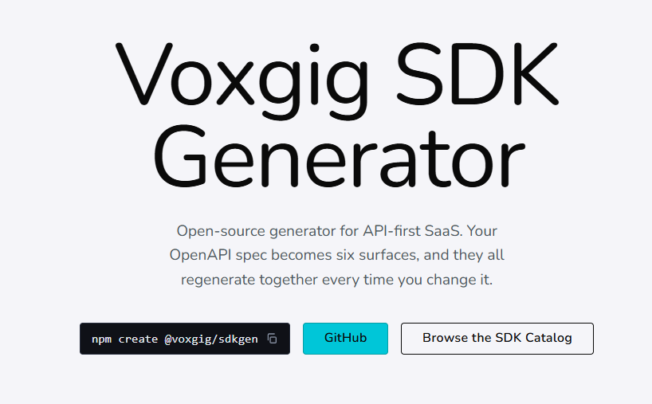
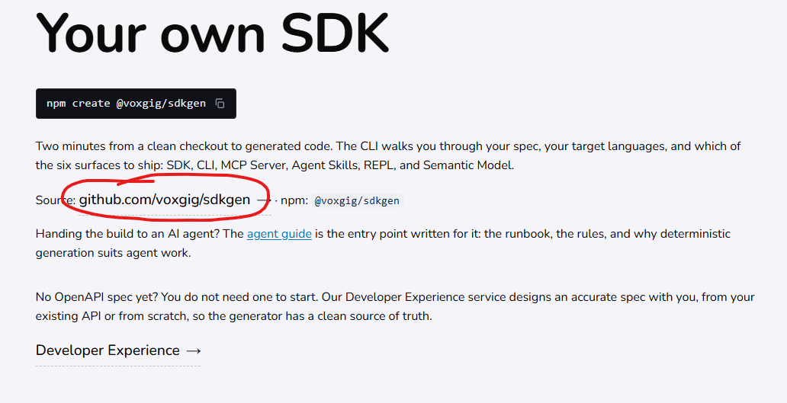
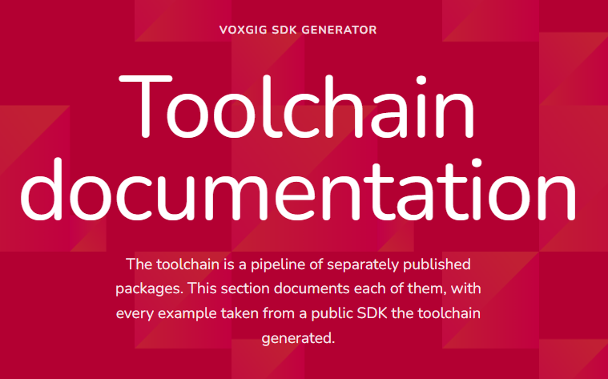
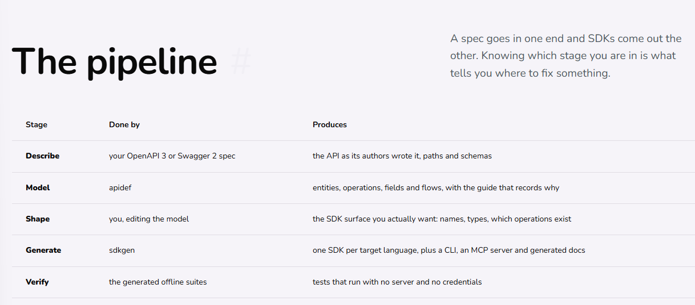
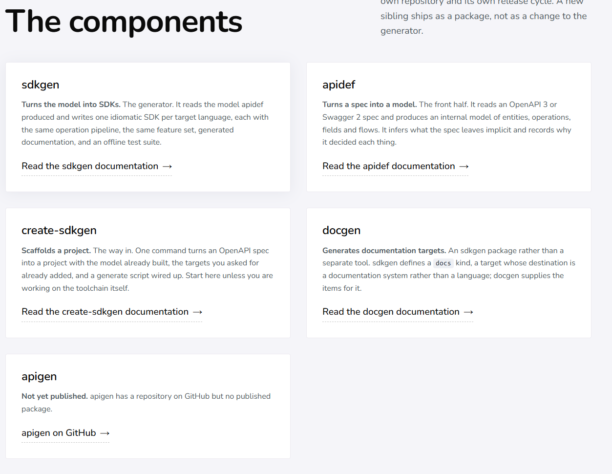
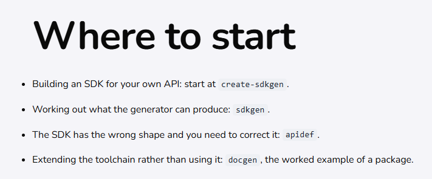

# Voxgig assessment notes - Task 1: Build an SDK and write a report

> [!NOTE]
> Environment disclaimer: I completed this assessment on **Windows 11**, AI-assisted with **Muse Spark 1.3 via OpenCode**.

This task asks you to build an open-source SDK under the MIT License in your own GitHub or GitLab account, using the Voxgig SDK tools, and write a short report on your observations. The project remains your open-source work, you retain the copyright, and you are free to reference it for other work.

Please choose an API that does not already have an SDK in our open-source catalogue:
https://github.com/orgs/voxgig-sdk/repositories

You may use AI or build it manually, so long as you use the Voxgig SDK generator:
https://voxgig.com/sdk

I recommend an API from a SaaS company with a free trial, since you will need an API key to test fully. A personal or side project with an API is also a good choice.

Please time-box the human work to 30 minutes maximum. If that is not enough, or if you find issues or bugs, that is fine: include them in your report. We are very interested in your developer experience with the generator.

There is no fixed deadline; about one calendar week is a useful guide.

Once this task is complete, we will send the second task under the same conditions.
## 👨‍💻 Human journey

Time-boxed to 30 min of human clicking, starting from the website as a new user who wants to "generate an SDK from my API". No GitHub, no prior knowledge.

**Summary:** the website buries the entry point. The real start (`create-sdkgen`) only appears at the bottom of `/sdk/docs#where-to-start`. The best onboarding (`README.md` + `agents.md`) lives in GitHub, not on the site. Result: ~25 min lost before knowing which tool to run.

### Step 1 - SDK landing: no entry point

URL: https://voxgig.com/sdk

<details>
<summary>Screenshots</summary>





</details>

- **Expected:** Marketing is expected, but also a "Getting started" somewhere with the install command on first screen.
- **Found:** generic landing. Scrolling to `sdk#your-own-sdk` shows an `npm create` command with a link to GitHub, but no runnable quick-start on the page itself.
- **Suggestion:** put a copy-paste quick-start on the landing page itself, not behind a GitHub link. The repo `README.md` and [agent guide](https://voxgig.com/sdk/agents.md) are the best docs in the project, I'd like to see them here.

### Step 2 - `/sdk/docs`: wrong labels, marketing instead of actual docs

URL: https://voxgig.com/sdk/docs

<details>
<summary>Screenshots</summary>





</details>

- **Expected:** structured technical documentation with prerequisites and first command.
- **Found:**
  - Section titled `Toolchain documentation`, as a user who wants to generate an SDK, I don't know what this has to do with my goal.
  - Section `The Pipeline` (https://voxgig.com/sdk/docs#the-pipeline) reads like marketing copy, not a getting started. Mentions `apidef` and `sdkgen` but never `create-sdkgen`, the tool I actually need to run. No links to those products.
- **Suggestion:** This "marketing" content should go to the **overview** on Step 1. Add here a  `Getting started` section and add the 3-step runbook here (same as `AGENTS.md`): scaffold → generate → build/test.

### Step 3 - `/sdk/docs > The Components`: first mention of the right tool, still no guidance

URL: https://voxgig.com/sdk/docs#the-components

<details>
<summary>Screenshot</summary>



</details>

- **Expected:** "use X to generate your SDK".
- **Found:** description of tools but no selection guidance. First time I see `create-sdkgen`. Unclear difference `sdkgen` vs `create-sdkgen`.
- **Suggestion:** one line on top: "To build a new SDK, use `create-sdkgen`. `sdkgen` is the engine it calls internally." Link both.

### Step 4 - `/sdk/docs > Where to start`: the answer, at the bottom

URL: https://voxgig.com/sdk/docs#where-to-start

<details>
<summary>Screenshot</summary>



</details>

- **Expected:** this content at the top of Step 2.
- **Found:** `Building an SDK for your own API: start at create-sdkgen`: 🎉🎉 Exactly what I searched for since Step 1 🎉🎉
- **Suggestion:** move this block to the top of `/sdk/docs` and to the landing page.

### Step 5 - GitHub repos: the actual docs

URLs:
- https://github.com/voxgig/create-sdkgen
- https://voxgig.com/sdk/agents.md

Only after Step 4 I learn that I have to use `create-sdkgen`. Since I don't find any guidance, I manually leave the website and go to GitHub. This is where I finally find what I needed from the start.

- **Expected:** the website to have a complete, up-to-date "Getting started", so I don't have to hunt it in the repos.
- **Found:** that repo's `README.md` and the [agent guide](https://voxgig.com/sdk/agents.md) are fantastic: clear quick-start commands, the real entry point. This is the content I wanted on the homepage in Step 1.
- **Suggestion:** mirror this quick-start on https://voxgig.com/sdk and at the top of https://voxgig.com/sdk/docs. As a user, I want everything I need on the website, not split across repos.

## 🤖 Robot journey

AI completed the same task with zero navigation friction, because it never used the website.

It treated the repos as source of truth: went straight to `create-sdkgen`, followed [Quickstart](https://github.com/voxgig/create-sdkgen/tree/main#quickstart) + [AGENTS.md](https://github.com/voxgig/create-sdkgen/blob/main/AGENTS.md), ran scaffold → generate → build/test. No lost time in Steps 1-4 above.

This is the contrast that matters: the human journey failed on the website, the robot journey succeeded by ignoring it. `AGENTS.md` is currently the best human onboarding doc in the project.

## Building the SDK in Windows

I picked [The Movie Database (TMDB)](https://developer.themoviedb.org/) to generate the SDK from. Spec: https://developer.themoviedb.org/openapi/tmdb-api.json

Next, I follow the [Quickstart](https://github.com/voxgig/create-sdkgen/tree/main#quickstart).

```sh
# 1. Scaffold a project from your OpenAPI 3 spec
create-sdkgen tmdb -d ./tmdb-api.json -o ./tmdb-sdk

# 2. Add the languages you want + offline test mode
cd tmdb-sdk/.sdk
npx voxgig-sdkgen target add ts py go
npx voxgig-sdkgen feature add test

# 3. Generate the SDKs (builds the .sdk sources, then runs the generator)
npm run generate

# 4. Verify
cd ../ts && npm install && npm run build && npm test
```

### Some comments

> [!WARNING]
> **Feedback:** The README [Quickstart](https://github.com/voxgig/create-sdkgen/tree/main#quickstart) and [AGENTS.md](https://github.com/voxgig/create-sdkgen/blob/main/AGENTS.md) have no **Prerequisites** section. The missing prerequisites are:
> - use Node 24+
> - install `create-sdkgen`
> ```sh
> nvm install 24
> nvm use 24
> npm install -g @voxgig/create-sdkgen 
> ```

### Bugs found

While actually running the steps on Windows I hit two errors and could not finish the generation. Both turn out to be **known, open issues filed by the maintainer**, so I am not doing anything wrong: the Windows path of the tool is currently broken.

#### Bug 1: `spawn npm ENOENT`

`create-sdkgen tmdb -d ./tmdb-api.json -o ./tmdb-sdk` fails at the install step:

```
INFO: create/jostraca generate-install running npm install in .\tmdb-sdk\.sdk
Voxgig Create SDK Error: Failed to start npm: spawn npm ENOENT
```

Known issue: [#58: Fix npm process launching in the generated scaffold on Windows](https://github.com/voxgig/create-sdkgen/issues/58)

#### Bug 2: `api/api-info.aontu` source not found

After installing the dependencies manually, `npm run generate` fails during the model build:

```
ERROR: model run-build build
  [aontu/multisource_not_found]: source not found: api/api-info.aontu
  --> .sdk\model\sdk.aontu:13:1
```

Known issue: [#62: Bare includes in the scaffold's model and test files fail to resolve, notably on Windows](https://github.com/voxgig/create-sdkgen/issues/62)


### Workaround: WSL

I repeated the [Quickstart](https://github.com/voxgig/create-sdkgen/tree/main#quickstart) in WSL, and the pipeline completed. `npm install` succeeded, `npm run generate` parsed the OpenAPI spec and generated the TypeScript SDK. `apidef` reported 103 entities from 148 paths, but marked the build partial with 13 selector-collision warnings; `sdkgen` also warned that some generated flow steps were unreachable.

### Offline test result

`npm test` completed with **908 tests: 800 passed, 0 failed, 108 skipped** (duration: about 4 minutes). These are the generated offline tests; they use a mock and do not by themselves test requests against TMDB.

### Test the SDK against the API

> [!NOTE]
> TMDB's OpenAPI spec marks `Authorization` as a bearer credential, but passing the raw Read Access Token as `apikey` returned `401 Invalid API key`. Prefixing it with `Bearer ` fixed authentication. The generated client did not add this prefix automatically. With the prefix, `GET /3/authentication` returned `200`, and the `Movie().load()` and `Movie().list()` entity calls returned live movie data.

Set the API key in PowerShell:

```powershell
$env:TMDB_APIKEY = "..."
```

I wrote a small script in the `tmdb-sdk\ts` folder:
```ts
import { TmdbSDK } from './dist/TmdbSDK.js'

const client = new TmdbSDK({ apikey: 'Bearer ' + process.env.TMDB_APIKEY })

// Test authentication
const res = await client.direct({ path: '/3/authentication', method: 'GET' })
console.log('ok:', res.ok, 'status:', res.status)
console.log(JSON.stringify(res.ok ? res.data : res.err, null, 2).slice(0, 1200))

// Test entities
const movie = await client.Movie().load({ id: 550 })
console.log('load:', movie.data().title, '|', movie.data().release_date, '| ★', movie.data().vote_average)

// Test search
const found = await client.Movie().list({ query: 'Fight Club' })
console.log('search hits:', found.length, '| first:', found[0]?.data?.().title)
```

Run it in PowerShell:
```powershell
node .\live-check.mjs
```

✅ It worked!

```
ok: true status: 200
{
  "success": true
}
load: Fight Club | 1999-10-15 | ★ 8.438
search hits: 20 | first: Fight Club
PS C:\Users\pablo\DEV\projects\tmdb-sdk\ts
```


## Conclusion

The website is confusing and full of marketing content, even on the pages titled "Documentation". A technical user would be lost and frustrated. The best material is in `AGENTS.md`, which is written for AI agents but is the most useful thing I found as a human.

1. The clearest runbook is in `AGENTS.md`. Although it is framed for AI agents, it is the best human onboarding doc in the project, and the website never points humans to it.
2. The names are easy to confuse: `create-sdkgen` versus `sdkgen`, the `npm create @voxgig/sdkgen` command silently running `create-sdkgen`, and two overlapping tutorials in separate repos.
3. Small remark: The examples assume the OpenAPI spec is YAML rather than JSON, even though the tool accepts both.
4. The [Quickstart](https://github.com/voxgig/create-sdkgen/tree/main#quickstart) is broken on Windows.
5. All the other small issues I found were easily fixed with the help of small model