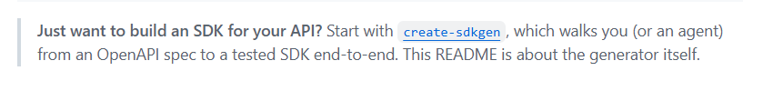

# Voxgig assessment notes

## Task 1: Build an SDK and write a report

- **Build** an open-source SDK under the MIT License in my own GitHub/GitLab account, and **write a short report** on my observations. I keep the copyright and may reference the work elsewhere.
- **Use the Voxgig SDK generator** — AI-assisted or manual is fine.
- **Pick an API** not already in the [catalogue](https://github.com/orgs/voxgig-sdk/repositories). Prefer a SaaS free trial, or a personal project with an API (an API key is needed to test fully).
- **Time-box my human work to 30 minutes.** Going over is fine. Note issues and bugs in the report.
- The report should cover my **developer experience with the generator**, which is what they are most interested in.

## Human journey

This is my personal journey to understand how to generate 

### SDK main page

Go to https://voxgig.com/sdk 


> [!NOTE]
> Nothing interesting.


#### ⚠️ SPOILER ⚠️

If I scroll down to https://voxgig.com/sdk#your-own-sdk 


That link goes to: https://github.com/voxgig/sdkgen 

In the [voxgigsdkgen section of README.md](https://github.com/voxgig/sdkgen#voxgigsdkgen) I can see what I was looking for:


> [!NOTE]
> That repo README.md and (Agents)[https://voxgig.com/sdk/agents.md] ARE ❤️fantastic❤️. 
> 
> That content is what I would like to see in the home page
> 
> As user I expect in the webpage to be a complete and updated "getting started" section and not having to go to the github repo.

**⚠️ But this is a shortcut, as user I want to find all the info I need in the webpage not in the github repo⚠️**


### SDK > docs

URL: https://www.voxgig.com/sdk/docs

Docs page. This is where I really expect to find a structured technical documentation. But I can't find it.

#### The Title


```
# Toolchain documentation

The toolchain is a pipeline of separately published packages. This section documents each of them, with every example taken from a public SDK the toolchain generated.
```

> [!NOTE]
> I don't like `Toolchain documentation` as title. I want to generate a SDK from an API, what has this to do with a `Toolchain`?

#### The Pipeline

URL: https://voxgig.com/sdk/docs#the-components


> [!NOTE]  
> When I see this, it looks like a real "getting started". But after reading it, I realize is a marketing thing rather than a technical guide
> - We are in the docs page, why not having the getting started here similar to what we have in the [README.md](https://github.com/voxgig/create-sdkgen/blob/main/AGENTS.md)
> - I see mentions to multiple Voxgig products like `apidef`, `sdkgen` (the reason I'm here) and not mention to `create-sdkgen`, the product I'm going to actually use ➡️ Feels confusing, why not having links to those products?

I scroll down to [The components](https://voxgig.com/sdk/docs#the-components)


> [!NOTE]
> - A description of tools but it's not which one I have to use to generate my sdkgen. 
> - Still looking for a real documentation and a getting started guide.
> - 1st time I see `create-sdkgen`, what's the difference between it and `sdkgen`?
> - 💀 At this point I'm lost and frustrated, I don't know what to do.

I scroll to the bottom of the page, [Where to start](https://voxgig.com/sdk/docs#where-to-start) section


> [!IMPORTANT]  
> 🎉🎉🎉 FINALLY!!!! `Building an SDK for your own API: start at create-sdkgen` 👈 This is what I was looking for since the begining!!

**⚠️ At this point I give up with the webpage and I go straight to the `create-sdkgen` github repo since now I know this is what I need ⚠️**

## Notes

- Always assumes in exmpales openapi is yaml and not json format
 
### Human journey conclusion

Following the documentation its frustating for a human. The docs are genuinely confusing Concrete evidence:
- Two packages (create-sdkgen, sdkgen) with near-identical names, in separate repos, where npm's npm create @voxgig/sdkgen command silently runs the other one.
- [Agents path](https://voxgig.com/sdk/agents) holds the clearest human runbook.
- The pipeline page names stages (Model, Generate) but not the commands or the packages that do them.
- Package-name-vs-CLI-name mismatches everywhere (@voxgig/sdkgen ↔ voxgig-sdkgen ↔ create-sdkgen).
- .aon vs .aontu extension churn mid-docs.

## Robot journey

If I ask an AI what are the steps to do the assesment it's very clear what I have to do.

### Prerequisites

- Node.js 24+ (`node -v`)
- Git and a GitHub account
- Your `openapi.json` file

### Step 1 — Scaffold the project

Open a terminal in the folder holding your `openapi.json`:

```sh
npm create @voxgig/sdkgen@latest -- my-api -d ./openapi.json -o ./my-api-sdk -t ts -f test
```

This creates `my-api-sdk/`. Inside it, `.sdk/` is your project; `ts/` will hold the generated SDK. `-t ts` = generate TypeScript; `-f test` = include the offline test suite.

### Step 2 — Generate the SDK code

```sh
cd my-api-sdk/.sdk
npm run generate
```

This reads `.sdk/model/` and writes the SDK into `ts/`.

### Step 3 — Build and test it

```sh
cd ../ts
npm install
npm run build
npm test
```

Green tests = the SDK works, offline, no API key needed.

### Step 4 — (Optional) One real call

Only if you have an API key, make a single live request to prove it works end to end. If you don't, skip — the offline tests already prove it.

### Step 5 — Push to your GitHub under MIT

```sh
cd ..                       # back to my-api-sdk/
git init && git add . && git commit -m "Initial SDK"
# create an empty repo on GitHub, then:
git remote add origin https://github.com/pablorotten/my-api-sdk.git
git push -u origin main
```

Add a `LICENSE` file with the MIT text (or let the scaffold's license stand).

### Step 6 — Write the report

Repo URL + what worked, what broke, where you got stuck, what you'd change. That's what Richard actually wants.

If something looks wrong in the output (wrong entity names, missing operations): edit the files in `my-api-sdk/.sdk/model/`, then re-run Step 2 and Step 3. Never edit `ts/` by hand — it gets overwritten.

That's the entire assessment. Two things I can do for you right now: pick an API, or run Step 1 against your `openapi.json` — do you have a spec file already?


## Conclusion

webpage is confusing and full of marketing content even in the pages with Documentation in the title. A technical user would be lost and frustrated. The dough is in agents.md that is meant to be ued for agents but it's actually the most interesting information for humans

1. The marketing site is the documented entry point, but the real documentation isn't there. Even /sdk/docs and /sdk/docs/create-sdkgen are marketing-shaped — stale (.aon), no runnable "start here" path.
2. The one page written clearly is written for the wrong audience. AGENTS.md — labelled "for AI agents" — is the best human onboarding doc in the whole project. The clearest runbook is hidden behind a repo file most humans won't open, because the site never says "the real guide is AGENTS.md."
3. The names defeat the reader. create-sdkgen vs sdkgen, @voxgig/sdkgen npm command launching @voxgig/create-sdkgen, two overlapping tutorials in two repos. Every step has a naming trap.